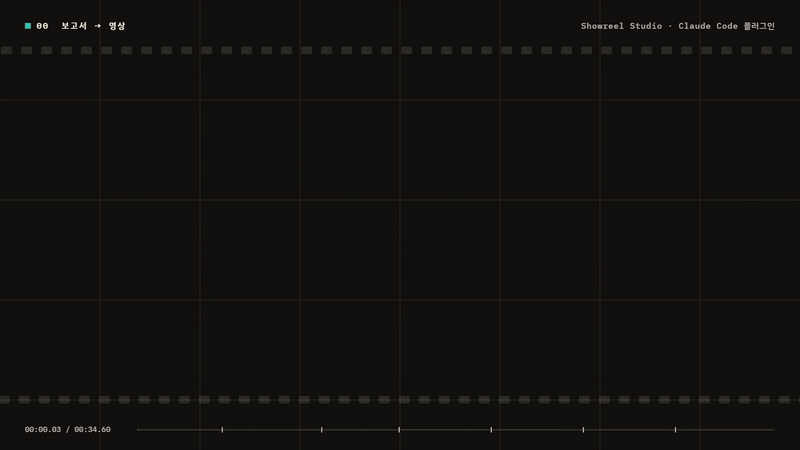

# Showreel Studio

조사 내용이나 보고서를 **한국어 모션그래픽 발표 영상**으로 만드는 Claude Code 플러그인입니다. 에이전트 3개와 스킬 4개로 이루어진 하네스입니다.

> *A Claude Code plugin that turns research reports into Korean motion-graphics presentation videos (storyboard → approval → canvas animation → layout audit & review → MP4 + web player with presenter mode).*



위 데모는 이 플러그인으로 만든 34.6초 쇼릴입니다. 소리가 있는 원본은 [docs/demo.mp4](docs/demo.mp4)이고, 코드 전체는 [example-showreel-reel.js](skills/reel-build/references/example-showreel-reel.js)에 있습니다.

## 무엇을 만드나

| 결과물 | 설명 |
| --- | --- |
| MP4 | 1920×1080, 30fps. 합성 음악과 효과음이 들어갑니다(음량 목표 -16 LUFS). |
| 웹 플레이어 | 장면마다 멈추는 **발표 모드**가 있습니다. →/PageDown으로 다음 장면, ←로 이전 장면, F로 전체 화면. |
| 대본 | 발표 보조 모드는 장면별 발표 대본을, 숏동영상 모드는 자막 대본과 SRT를 만듭니다. |

| 모드 | 길이 | 설명을 맡는 것 |
| --- | --- | --- |
| 발표 보조 (기본) | 90초~2분 30초 | 발표자(장면별 대본 제공) |
| 30초 요약 | 30초 | 화면 문구 |
| 숏동영상 | 3~5분 | 화면 자막(발표자 없이 이해되는 설명 영상) |

## 작동 방식

```
사용자 요청 ─▶ ① reel-storyboarder   원자료에서 검증된 사실만 골라 장면·문구·타이밍·효과음 설계
                     │
               ② 사용자 승인          영상은 만든 뒤 고치는 비용이 커서 방향을 먼저 확정
                     │
               ③ new-reel.js          템플릿 복사, 렌더러 설치(처음 한 번)
                     │
               ④ reel-builder         캔버스 애니메이션 코드 작성 + 스스로 레이아웃 검사
                     │   ▲
               ⑤ reel-reviewer ──┘   겹침·잘림·읽기 시간·수치 출처·효과음 대조 (최대 2라운드)
                     │
               ⑥ 렌더링 · 게시         headless Chrome으로 프레임 → ffmpeg로 MP4, 웹 번들
```

- **결정론적 렌더링**: 모든 프레임을 시간 `t`만으로 그립니다. 웹 페이지, MP4, 자동 검사가 같은 그림을 봅니다.
- **레이아웃 자동 검사**(`render.js audit`): 화면 밖으로 나간 글자, 여백 침범, 겹침, 읽기 시간 부족(한국어 기준 약 8음절/초)을 장면·시각별로 찾아냅니다.
- **사실 우선**: 스토리보드는 화면의 모든 수치에 출처를 붙이고, 검토자가 원자료와 대조합니다.

## 설치

### 플러그인으로 (권장)

Claude Code에서:

```
/plugin marketplace add YUjinEDU/showreel-studio
/plugin install showreel@showreel-studio
```

설치하면 스킬은 `/showreel:showreel-studio`, 에이전트는 `showreel:reel-builder`처럼 이름 앞에 `showreel:`이 붙습니다.

### 프로젝트에 직접 복사

`skills/`의 네 폴더를 프로젝트의 `.claude/skills/`에, `agents/`의 파일을 `.claude/agents/`에 넣습니다. 이 경우 `skills/showreel-studio/SKILL.md`의 `subagent_type`에서 `showreel:` 접두어를 빼야 합니다.

### 준비물

- Node.js 18 이상
- Chrome 또는 Edge. 찾지 못하면 `CHROME_PATH` 환경변수로 실행 파일 경로를 지정합니다.
- 첫 실행 때 프로젝트의 `showreel/tools/`에 렌더러가 복사되고 `npm install`(puppeteer-core, ffmpeg-static)이 실행됩니다. 약 120MB입니다.

## 사용 예

```
보고서 reports/my-research.md 로 발표용 2분 영상 만들어줘
이 내용으로 주제를 모르는 사람에게 보여줄 3분 숏동영상 만들어줘
30초 요약 버전도 만들어줘
3번 장면 문구만 고쳐줘 / 음악만 더 차분하게 / 다시 렌더링
```

결과물 위치(사용자 프로젝트 기준):

```
showreel/reels/{YYYY-MM-DD}-{slug}/   영상 소스(index.html, reel.js, engine.js, music.js)
  └── _work/                          브리프, 스토리보드, 구현 기록, 검토 의견 (과정 기록)
reports/{date}_{topic}-showreel.mp4   최종 영상과 대본
```

## 구성

| 종류 | 이름 | 역할 |
| --- | --- | --- |
| 스킬 | `showreel-studio` | 오케스트레이터. 단계 조율, 승인, 렌더링·게시, 부분 재실행 |
| 스킬 | `reel-storyboard` | 사실 선별, 장면 구성, 타이밍 규칙, 대본·자막 규칙, 출력 형식 |
| 스킬 | `reel-build` | 엔진 API, 레이아웃 규칙, 애니메이션 패턴, 효과음·음악 설정 |
| 스킬 | `reel-review` | 자동 검사 해석, 프레임 확인, 출처 대조, 심각도(must/should/could) |
| 에이전트 | `reel-storyboarder` | 구성 작가 겸 아트 디렉터 (opus) |
| 에이전트 | `reel-builder` | 크리에이티브 코더. 수정 라운드 동안 맥락 유지 (opus) |
| 에이전트 | `reel-reviewer` | 방송 그래픽 QC. 코드는 고치지 않음 (sonnet) |

템플릿(`skills/showreel-studio/assets/template/`): 캔버스 엔진 `engine.js`(텍스트·도장·카운터·자막·전환·레이아웃 기록), 합성 음악 `music.js`(스타일 `intro/drive/calm/pulse/half/breakdown`, 효과음 큐, BS.1770 음량 맞춤), 렌더러 `render.js`(sheet, frames, audit, audio, video, bundle).

## 알아 둘 점

- **한국어 전용**입니다. 글꼴(Black Han Sans, IBM Plex Sans KR), 읽기 속도 기준, 문구 규칙이 한국어에 맞춰져 있습니다.
- **토큰 사용량이 큽니다.** 3분 숏동영상 한 편에 스토리보드 약 60만, 구현 약 40만 토큰이 들었습니다(수정 요청 여러 번 포함).
- **Windows에서 검증**했습니다. 렌더러는 macOS/Linux의 Chrome 경로도 찾지만 아직 시험하지 않았습니다.
- **웹 게시**는 claude.ai Artifact 도구가 있을 때만 자동으로 합니다. 없으면 `npx http-server showreel/reels/{slug}`로 로컬에서 재생합니다(음악을 fetch로 읽어서 파일을 직접 열면 소리가 나지 않습니다).
- 음악은 코드로 합성합니다. 음량은 측정하지만 듣기 좋은지는 사람이 확인해야 합니다.
- 완성 예제 `skills/reel-build/references/example-showreel-reel.js`는 맨 위 데모 영상의 코드입니다. 테마 → 소재 함수 → 장면 → 장면 표 → 효과음 큐 → 음악 순서로 읽을 수 있게 주석을 달았습니다. 구현 에이전트가 처음 구현할 때 이 파일을 참고합니다.

## 만든 과정

한 대학 수업 프로젝트에서 조사 결과를 발표하려고 만들었고, 같은 프로젝트에서 영상 6편(30초, 2분, 3분, 5분)을 만들면서 다듬었습니다. 맨 위 데모는 공개용으로 따로 만든 일곱 번째 영상입니다. 검토자가 지적한 문제(자막 읽기 시간, 음량, 출처 표기)는 스킬 규칙과 엔진 기능으로 되돌려 넣었습니다.

## 라이선스

MIT. 글꼴은 Google Fonts에서 불러오며 각 글꼴의 라이선스(SIL OFL)를 따릅니다.
